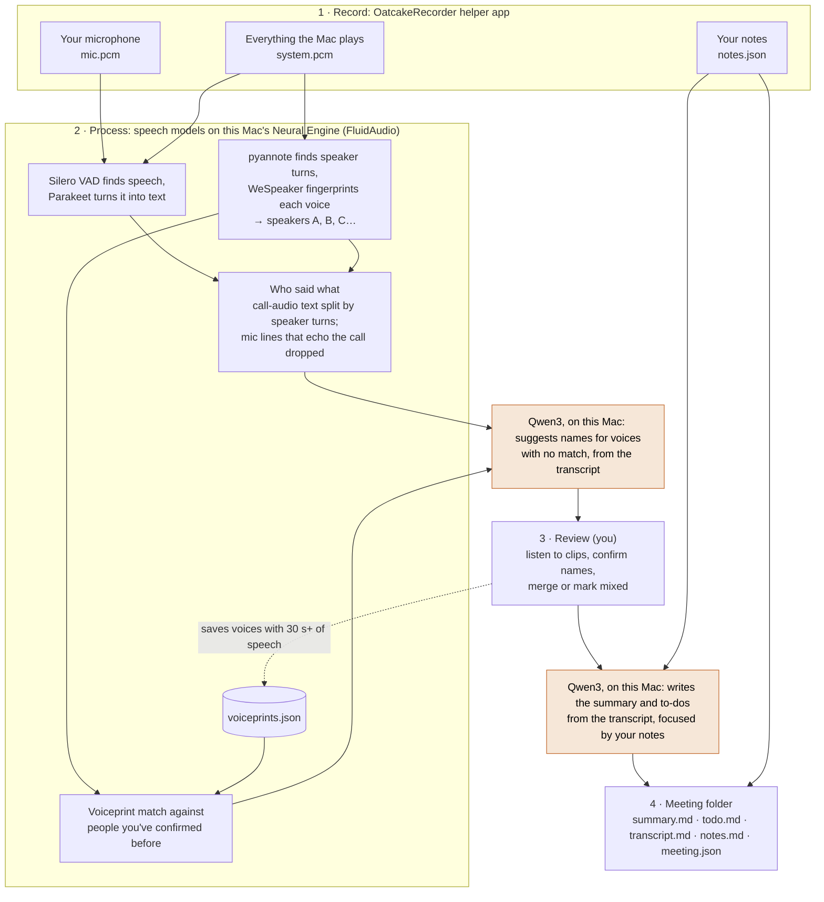

# Oatcake

A Mac app that records a call, transcribes it on this Mac, tells the other voices apart,
lets you check who said what, and writes a summary built around the notes you took
during the call.

## How it works



Everything runs on this Mac, and nothing from a call is sent anywhere unless you set a folder to sync (see Sharing folders). Silero, Parakeet, pyannote
and WeSpeaker are small speech models (Parakeet is 0.6B parameters), run on the Neural Engine
through [FluidAudio](https://github.com/FluidInference/FluidAudio)'s Core ML builds: they turn
audio into text and voices into fingerprints, take no prompts, and can't write anything else. The
two orange steps are the only language model: Qwen3, which Oatcake downloads once and runs itself
with [llama.cpp](https://github.com/ggml-org/llama.cpp) (see Language model). It only ever sees
text (the transcript and your notes), never audio. You can point Oatcake at a model server of
your own, on your Mac or your network, instead.

The window has three columns: the sidebar (a recording in progress, Upcoming from your
calendar, Needs review, and your folders), the meetings in the selected folder, and the
meeting itself. Settings (⌘,) is its own window, in panes; changes apply as you make them.
⌘N starts a new recording, ⌥⌘F searches every meeting from the box above the meeting list (its
title, folder, summary, to-dos, notes and transcript; a meeting found by its text shows the line
with the words and opens there), and ⌘F finds words in the transcript you're reading. ⇧⌘N makes a
folder and ⌘R refreshes the calendar; all of these are in the File and Edit menus. ⌘- or
⇧-click selects several meetings in the list, and right-click or File › Move to Trash (⌘⌫) moves
them all to the Trash.

1. **Record.** New recording, or click an event under Upcoming. Pick the folder (a calendar
   event picks the folder named like it, or the one its earlier meetings are in, or offers a
   new one for a recurring event); leave
   the title blank to use the folder's name. The screen shows the event's attendees, the
   open to-dos from the last meeting in that folder (ticking one updates its `todo.md`),
   and takes prep notes, which open the call's notes: type them one at a time or paste a
   list, which becomes a note per line. They're kept for that call until it's recorded, so
   you can write them ahead and come back. Your microphone is recorded as you;
   everything the Mac plays (Zoom, Meet, Slack, anything) is recorded as the other people.
   During the call, write one point per line: each is stamped with the time you started
   typing it, and every line stays editable. The recorder is a small helper app
   (`Sources/OatcakeRecorder`), so macOS asks for microphone and system-audio permission for
   "OatcakeRecorder" once; if it hasn't started after a few seconds, the live screen says
   to look for that prompt. Pick the microphone on the record screen, from the mic button
   during the call, or in Settings: "Same as Mac" follows System Settings › Sound; a chosen
   mic is used until it's unplugged, then the Mac's input until it's back. Changing mic
   mid-call carries on recording, with the switch filled with silence so your track stays
   lined up with the call. You're warned after 30 seconds of a silent mic or no call audio.
   Stop asks first.

   Beside your notes, **Transcript** shows the call as it's said, a moment after each pause
   (a second helper, `Oatcake --live`, transcribes the audio as the recorder writes it). Your
   lines are yours; each line from the call side gets an obviously made-up name, a different
   one every time ("Mystery Guest", "Captain Placeholder"…), until the call is over and the
   voices are told apart.
   Settings › General turns the live transcript off.

   **Calls are noticed.** When a calling app or a browser starts using your microphone and
   nothing is being recorded, a notification offers **Start recording** (under the calendar
   event happening now, if there is one). A recording that has had a calling app on the
   microphone stops by itself once that app has let go and the call audio has been quiet for 15
   seconds, and starts processing; music still playing, or a call you're only muted on, keeps
   it going. Oatcake tells which apps have a microphone open from Core Audio
   (`Sources/OatcakeCore/CallDetector.swift`); it doesn't listen until you record. Both are
   switches in Settings › General.

   While a call is being recorded the **menu bar** shows its running time, with Stop in its
   menu. (The menu bar item is drawn by a third helper, `Oatcake --menu-bar`, a menu-bar-only
   app: macOS doesn't show a Dock app's menu bar menu while another app is in full screen.)
   A recording started from a calendar event keeps the event's **Join the call** button on
   its screen, for when you press record before joining.
2. **Process (on this Mac, in the background).** Parakeet transcribes both tracks. The call
   audio is split into voices by FluidAudio's batch diariser (pyannote segmentation, WeSpeaker
   fingerprints, VBx clustering). It runs as a helper process (`Oatcake --analyse`), so a
   problem there can't take the window or a recording in progress with it. Mic lines that repeat the call audio (speaker echo) are
   dropped. Known voices are recognised from saved voiceprints; other names are suggested
   from the conversation by the summary model, quoting the words that gave it away. The
   recording waits under Needs review with its step (1–5); a failure shows the reason, with
   Try again and Discard.
3. **Review (Who's who).** Change the title or the folder it's saved in if you want to. One card
   per voice: play its clips, confirm or type the name, or pick one of the people on the call's
   calendar invite (each is offered until they've been given a voice)
   (with where the suggestion came from), merge it into another voice or into you, or mark
   it as mixed ("Several people"). Unnamed voices are saved as "Voice 1", "Voice 2"… The
   transcript beside it updates as you name voices. Confirmed voices with 30+ seconds of
   speech are saved, so they're recognised next time.
4. **Save.** The meeting is a folder in the folder you picked:
   `2026-11-05 1400 Weekly sync/` with `summary.md`, `todo.md` (action items, as
   `- [ ] Task — Owner — due Fri, Oct 30 — [12:34]`), `transcript.md`, `notes.md` (your own
   notes, untouched; prep notes have no time) and `meeting.json` (title, times,
   participants). Saving doesn't involve the summary model: the meeting is written straight
   away with its transcript and notes, and its summary and to-dos are written in the background
   and appear in the meeting when they're ready. If the summary can't be written (the model's
   download was interrupted, a server of your own that's down), the meeting says why in plain words
   (the raw message is behind Details) and shows **Write summary** to try again later. Your notes
   steer what the summary focuses on but aren't copied into it. A long turn in the transcript is
   broken at a pause about every half minute, each part with its own time.
   Tabs: Summary (with the meeting's to-dos at the top), Transcript and My notes (⌘1–⌘3),
   each Rendered or as editable Markdown from the switch at the top right of the note (saved as
   you type; Summary shows `todo.md` and `summary.md`). **Copy** puts the tab you're on (the summary with its to-dos, the transcript,
   or your notes) on the clipboard as Markdown under the meeting's title and date, and **Share**
   sends the same text with Mail, Messages or another app. Tick to-dos off in place; a to-do's time jumps to that moment in the
   transcript. **To-dos** at the top of the sidebar gathers every meeting's to-dos (open
   and overdue counts beside it): Open / Done / All, grouped by due date, folder or owner,
   filtered by owner ("Mine" is your name from Settings). Ticking one there updates that
   meeting's `todo.md`, and under Open it leaves the list (it's under Done if you didn't mean it). Add a to-do under a meeting's Summary and it goes in that meeting's
   `todo.md`; add one on the To-dos page and it goes in the Meetings folder's own `todo.md`,
   owned by you unless you name someone. Type owner and due date after dashes:
   `Send the deck - Alex - due Fri, Nov 6`. The middle column's width drags, like the
   sidebar's. Organise meetings by dragging them onto folders, or
   right-click to rename or trash; Finder and the app stay in step. Renaming a meeting changes
   its title (in `meeting.json`) and its folder's name, which keeps its date.
5. **Ask.** The lozenge at the bottom of a meeting takes questions about it ("what did we
   decide about hiring?") or across meetings ("when did Alex first raise the launch date?").
   The model on your Mac is given the meeting you have open, whole: its summary, to-dos, your
   notes and the transcript. It's first asked whether the question reaches beyond that meeting.
   When it does, Oatcake searches your other meetings for the names and topics the model gives,
   looks at the earlier meetings in the same folder, and adds their summaries, to-dos and the
   transcript lines that match. The model never opens a file or runs anything itself. Answers
   link to the meetings they draw on, and a time in an answer opens the transcript at that moment.
   An answer is one piece of text: select any stretch of it, or all of it, and copy.
   Web links in an answer are shown as text, not made clickable. Follow-ups continue the same conversation,
   which stays open as you move between meetings, until New chat. The first question about a call
   takes longest, while the model reads it; follow-ups about the same call are quicker.

## Importing from Granola

Export your notes from Granola (it gives you a `.zip` holding a CSV), then in Oatcake open
Settings › Storage › **Import from Granola…** and pick the `.zip` (or the CSV inside it). Each
note becomes a meeting folder with `summary.md`, `transcript.md`, `notes.md` (when Granola kept
your notes) and `meeting.json`, under a **Granola** folder in your Meetings folder. Notes that
share a title, like a weekly meeting, are grouped in a subfolder named after it; drag folders
wherever you like afterwards. Each meeting remembers its Granola note, so importing the same
export again (or a newer one) skips meetings that are already there, wherever you've moved them.

Granola's export has no speaker names or timestamps in its transcripts, so they show as plain
paragraphs, and it has no participants or end times. The import is in
`Sources/OatcakeCore/Granola.swift`.

## Importing from Quill

Make a backup in Quill (it gives you a `QuillBackup-<date>.zip`), then in Oatcake open
Settings › Storage › **Import from Quill…** and pick the `.zip`. Each meeting becomes a meeting
folder under a **Quill** folder, with meetings that share a title grouped in a subfolder as for
Granola. The folder holds:

- `transcript.md`, with times and speakers: your microphone is you, and voices on the call carry
  the names Quill matched to them, or "Voice 1", "Voice 2"…
- `summary.md`, made from Quill's notes on the meeting, if it wrote any.
- `audio.m4a`, the combined recording, whatever **Keep call audio** is set to. Quill's separate
  mic and system tracks are left out.
- `meeting.json`, with the start and end times and the people named in the transcript.

Quill's search index (`vector_store.db`), contacts, threads and settings aren't imported, and
neither is a meeting with nothing in it (no words, notes or recording). Importing again skips
meetings already there. The import is in `Sources/OatcakeCore/Quill.swift`.

## Sharing folders

Off unless you set it up. Sharing puts the folders you choose on a [Spacefast](https://spacefast.com)
Space of your own, as pages other people can be given, folder by folder.

- **Set up** (Settings › Sharing): the Space's name and an API key limited to it that can publish
  and manage access. The key is kept in your Keychain. Use a private Space in a team with nobody
  else in it: everyone in the team that owns a Space can read all of it, and Check says so when
  there's anyone.
- **Sync a folder**: right-click it in the sidebar, Sync to Spacefast. Its meetings are published
  as pages, and again whenever something in it changes, without a press each time. A folder inside
  a synced folder syncs with it. Folders that aren't synced never leave the Mac.
- **What's published**: each meeting's summary and to-dos, and its transcript only if the folder's
  Share sheet says so. Your own notes and the call audio never are. Pages are plain HTML made from
  the Markdown with everything escaped; only web links are links.
- **Share a folder**: Share… on a synced folder, then a name and an email address. Spacefast emails
  the person a link; they need no account, and can read that folder and everything inside it.
  Nobody but you can read a synced folder until you add someone.
- **Addresses** follow the folders, in plain lower-case words: `Clients/Acme Corp` is at
  `…/clients/acme-corp/`. Two folders that would get the same address stop the sync until one is
  renamed.

Access on Spacefast belongs to an address, not to a folder, so Oatcake errs towards taking it away:

| What happens | Its pages | Its readers |
|---|---|---|
| A synced folder is renamed or moved in Oatcake | Follow it to the new address | Removed; add them again |
| Something is moved into a shared folder | Go with it | Asked first, naming who will be able to read it |
| A synced folder is renamed, moved or deleted in Finder, or while Oatcake is closed | Removed | Removed |
| Sync is turned off for a folder | Removed | Removed |

Each sync takes access away first, then publishes the pages as the whole of the Space (anything
no longer synced is gone from the live site), then revokes any link that opens the Space, and only
then gives new access; if a step fails, the ones after it don't happen. A Meetings folder that
isn't there (a drive not connected) stops the sync rather than emptying the Space. Spacefast keeps
earlier versions of a Space, which only its owner can reach, so a page removed from the live site
isn't erased from Spacefast.

Not built yet: signing in to Spacefast from the app rather than pasting a key, and choosing people
from a meeting's attendees.

## What's next

None of this is built yet. It's what we'd like to add, in no fixed order.

**Notes**

- A summary as soon as a call has been processed, before Who's who, with the names put right
  once you've confirmed them.
- Templates for summaries (a one-to-one, a customer call, a stand-up), and writing a summary
  again with a different one.
- Asking for a change to a summary: "shorter", "add the numbers we agreed".
- Your own notes worked into the summary, each point with where it came from in the transcript.
- A brief before a call: what was agreed and what's still open from the last one with the same
  people.

**During a call**

- Ask while the call is still going.
- Names beside the call side of the live transcript.
- Pause and resume.
- Meetings in a room: telling apart the voices on your microphone, as the call side is today.

**Finding things**

- Saved questions for Ask, and choosing the folder or person it looks through.
- A page for each person: the meetings they were in and the to-dos they own.
- A way for other tools and assistants to read your meetings (an MCP server over the Meetings
  folder).

**Transcription**

- Jargon given to the speech model too, so the transcript itself spells names as you wrote them.
- More languages, and calls that move between them.

**Setting up**

- A notarised download, so macOS opens Oatcake without the warning or the Terminal line.

## Install

Needs an Apple Silicon Mac on macOS 15 or later (FluidAudio's diariser hits a Core ML bug that
Apple fixed in macOS 15). Oatcake isn't notarised by Apple, so macOS won't open a copy downloaded
with a browser until you allow it. There are two ways to install it.

**From Terminal.** Paste this:

```sh
curl -fsSL https://raw.githubusercontent.com/a8cteam51/oatcake/trunk/install.sh | sh
```

It downloads the latest release, checks its checksum and code signature, puts
Oatcake in Applications (or `~/Applications` if you can't write there) and opens it. Files that
curl downloads don't get macOS's quarantine flag, so there's no warning to get past. Run it again
any time to reinstall.

**By hand.**

1. Download `Oatcake-v…-arm64.zip` from the
   [latest release](https://github.com/a8cteam51/oatcake/releases/latest) and open it to unzip it.
2. Drag Oatcake into your Applications folder and open it. macOS says it couldn't check Oatcake
   for malware and doesn't open it. Choose Done, not Move to Trash.
3. Open System Settings › Privacy & Security, scroll down to Security, and click **Open Anyway**
   beside the note about Oatcake.
4. Open Oatcake again and choose **Open Anyway**. macOS remembers this, and Oatcake updates itself
   from then on.

Either way, the first recording asks for microphone and system-audio permission for
"OatcakeRecorder". There's nothing to sign in to and no key to paste: the models run on your Mac,
and Oatcake fetches them itself during your first call, into
`~/Library/Application Support/Oatcake/models`. The language model that writes summaries starts
downloading when you start recording (Qwen3 8B, 5.0 GB, on a Mac with 16 GB of memory or more;
Qwen3 4B, 2.5 GB, on one with 8 GB), and the speech models (about 500 MB) when the call is
processed. See Speech models and Language model.

## Updates

Oatcake looks for a new release 20 seconds after it opens and then once a day (Settings ›
Updates can turn that off, and has Check Now). A new release shows in the sidebar above
Settings; **Update** downloads it, checks it, and quits and reopens Oatcake on the new version.
It waits while a call is being recorded, analysed or saved. Nothing is installed until you
click.

Each release carries `latest.json`, a manifest naming the version and its zip (address,
SHA-256, size), signed with Oatcake's Ed25519 release key. Oatcake checks that signature
against the public keys it ships (`Update.publicKeys`), checks the zip's size and
checksum, unpacks it with `ditto`, checks it's Oatcake at that version, and checks the new app
is signed with the same certificate as the running one (`codesign --verify --deep --strict -R`
with the running app's designated requirement). The new copy is staged next to the installed
one; a small detached script waits for Oatcake to quit, swaps the two, and opens it. Its log is
`~/Library/Application Support/Oatcake/update.log`. The mechanics are in
`Sources/OatcakeCore/Update.swift`.

A copy that can't replace itself says why in Settings and offers the install line instead: a
development copy, one built without the release certificate, one in a folder you can't write
to, or one macOS is running from a quarantined download.

## Build from source

Needs Xcode's command line tools (`xcode-select --install`, Swift 6.2 or later); Xcode itself
isn't needed.

```sh
swift build                  # debug build of everything
swift test                   # the core's tests
Scripts/bundle.sh            # build/Oatcake.app, release build, recorder and llama.cpp inside
Scripts/bundle.sh debug      # the same, debug build
```

`Scripts/bundle.sh` signs with the "Oatcake Release" certificate when that's in your keychain,
and ad-hoc otherwise. macOS ties the recorder's microphone and system-audio permission, and
Oatcake's Keychain items, to the signature: an ad-hoc build is a new app to macOS every time
(so it asks again), and only a release-signed copy can update itself. The Dock badge counts
recordings waiting under Needs review. The icon is `assets/icon.svg`; `assets/Oatcake.icns` is
built from `assets/icon.png` with `iconutil`.

`Scripts/bundle.sh` also puts llama.cpp's server in the app: one fixed build from llama.cpp's
releases, downloaded once into `.build/llama` and checked against its SHA-256. A copy run straight
from `swift build` has no llama.cpp beside it; point `OATCAKE_LLAMA_DIR` at a folder that holds
`llama-server` and its libraries (`build/Oatcake.app/Contents/Resources/llama` will do).

To try a build without touching your own recordings, settings and voiceprints, point it at
another data folder (and set a different Meetings folder in its Settings):

```sh
open -n --env OATCAKE_DATA_DIR=/tmp/oatcake-test build/Oatcake.app
```

With only the command line tools, SwiftUI's `@State` macro isn't available (its plugin ships with
Xcode), so views use the `State` property wrapper through the `ViewState` alias.

## Releasing

Bump the version and push its tag:

```sh
Scripts/version.sh patch     # or minor; commits VERSION and tags v0.4.1
git push --follow-tags
```

The Release workflow (`.github/workflows/release.yml`) runs the tests, builds the app on a
GitHub Mac runner, signs it and the recorder with the release certificate (and stops if either
ends up with any other signature), zips it, writes and signs `latest.json`
(`Scripts/sign-manifest.swift`) with the commit subjects since the previous tag as notes,
attaches both to a new GitHub release, and checks the public feed serves that `latest.json`. It
stops if the tag doesn't match `VERSION`. Running it by hand from the Actions tab builds and
signs without releasing.

It needs three repository secrets:

- `OATCAKE_SIGNING_P12` and `OATCAKE_SIGNING_P12_PASSWORD`: the "Oatcake Release" code-signing
  identity (a self-signed certificate valid until 2046), base64-encoded `.p12` and its password.
  It isn't from Apple, so it doesn't satisfy Gatekeeper; what matters is that every release
  carries the same one, so permissions survive updates and installed copies accept the next
  release.
- `OATCAKE_UPDATE_KEY`: the Ed25519 private key that signs `latest.json` (base64 PKCS#8 DER).
  `swift Scripts/sign-manifest.swift keygen` makes a new pair.

Keep copies of the certificate and the update key somewhere safe outside GitHub (secrets can't be
read back). If the certificate is lost, installed copies won't accept releases signed with a new
one and need the install line once. To replace the update key, add the new public key to
`Update.publicKeys`, release, and only then sign with the new key.

To build release-signed copies locally (so a rebuilt recorder keeps its permissions), import the
`.p12` into your login keychain; `Scripts/bundle.sh` then uses it. To try an update before
publishing it, serve a folder holding a zip and its `latest.json` and start Oatcake with
`OATCAKE_UPDATE_FEED=http://127.0.0.1:8000/latest.json`; `install.sh` takes `OATCAKE_FEED` the
same way. With either, the zip is fetched from beside the manifest.

Four more environment variables help when trying things out: `OATCAKE_DATA_DIR` points a
development copy at another data folder (not another Keychain: don't save a real calendar address in one);
`OATCAKE_LLAMA_DIR` names the folder llama.cpp's server is in, for a copy that isn't a bundle;
`OATCAKE_CALENDAR_URL` gives it a calendar address without saving one (a local `.ics` served over
HTTP will do); and `OATCAKE_CALL_APPS` names a file listing the apps to treat as on a call, one
per line, so the call notice and the automatic stop can be tried without making a call.

## Speech models

FluidAudio is pinned to an exact version in `Package.swift`, with only its diarisation trait
(no text-to-speech, no prebuilt text-normalisation library). The models come from
FluidInference's Hugging Face repositories at fixed commits (`SpeechModels.pinnedRevisions`;
FluidAudio pins the diarisation models itself), so a change to a repository can't change what
Oatcake runs. Updating either is a deliberate change: bump it, then check transcripts and
speaker separation on a known meeting.

| Model | Used for | Licence |
| --- | --- | --- |
| Silero VAD | finding speech | MIT |
| Parakeet TDT 0.6B v2 | English transcription (default) | CC-BY-4.0 |
| Parakeet Ultra (post-trained v3) | 25 European languages | CC-BY-4.0 |
| pyannote community-1 segmentation and embedding | speaker turns and voice fingerprints | CC-BY-4.0 |

## Language model

Summaries, to-dos, name suggestions and Ask's answers come from one model, run on this Mac.

| Model | For | Download | Licence |
| --- | --- | --- | --- |
| Qwen3 8B (Q4_K_M) | Macs with 16 GB of memory or more; the default there | 5.0 GB | Apache-2.0 |
| Qwen3 4B (Q4_K_M) | Macs with 8 GB; fine on short calls, loses detail on long ones | 2.5 GB | Apache-2.0 |

- **Where it comes from.** Qwen's own GGUF files on Hugging Face, at a fixed revision, checked
  against their SHA-256 before use (`LocalModels` in `Sources/OatcakeCore/LocalModel.swift`). A
  download that's interrupted carries on from where it stopped. Settings › Summaries shows how far
  it has got, downloads it on request and removes it.
- **What runs it.** llama.cpp's server, inside Oatcake.app (MIT; the build is named in
  `Scripts/bundle.sh`). Oatcake starts it when there's something to write, on 127.0.0.1 at a port
  picked for the occasion, with a key made up each time so that a web page or another account on
  the Mac can't use it, and stops it after ten minutes with nothing to do, which gives its memory
  back.
- **How it's asked.** As Qwen advises for these models: its own sampling settings, never greedy
  decoding and room for a long reply. Whether it reasons before it replies is set for each task
  (Settings › Summaries): on to start with for summaries, name suggestions and Ask, where it
  measured better (decisions given to the right person, fewer invented names, answers that keep
  to the question), and off for to-dos, which lost detail with it. The summary and the to-dos are
  two requests about the same transcript, each with its task after the transcript; the to-dos,
  the name suggestions and Ask's first step come back as JSON the server holds to a schema, sent
  as it's written: the model fills in the fields in the schema's order, and a to-do's task has to
  come before its time (time first, it makes a to-do of every few minutes of the call). The
  summary's instructions are yours to change, and so is what counts as a to-do (Settings › Summaries).
- **How much it reads at once.** As little as the job needs, up to what this Mac's memory allows
  (the 8B takes about 5 GB plus 0.14 GB for every thousand tokens; an hour's call is around
  12,000). Qwen3 reads 32,768 tokens natively; a longer call stretches that with YaRN, by no more
  than it needs. A call too long for this Mac is summarised in parts, which are then joined.
- **A model of your own.** Any server with the same chat API on this Mac or your network (Ollama,
  LM Studio, your own llama.cpp). Oatcake only talks to a local address, and sends no key.

Changing the model or llama.cpp's build is a deliberate change, like the speech models: change the
revision and checksum together, then check summaries, to-dos and names on a known call.

## Moving from the Electron version (0.3 and earlier)

0.4.0 is the same app rebuilt in Swift, with the same bundle ID, certificate and update feed, so
0.3.0 updates to it in place. The first launch:

- moves the calendar address from `secrets.json` (Electron's encrypted store) into your
  Keychain, then deletes `secrets.json`;
- drops the keys for the Anthropic API and for an OpenAI-compatible service, if you'd saved
  either: summaries are written by a model on your Mac now. Settings that named Claude become the
  model recommended for your Mac; a model server on your own Mac or network carries over;
- deletes the old sherpa-onnx models (about 700 MB) and Electron's `Chromium` cache folder;
- keeps everything else as it was: `config.json`, the Meetings folder, recordings waiting for
  review, and `calendar.json`.

Voice fingerprints come from a different model now, so `voiceprints.json` keeps the names it
knows (they're still offered in review) but not their old fingerprints: each person is
recognised again after one saved call. A recording analysed by the old version but not yet
saved can still be reviewed and saved; its fingerprints aren't kept. Avatar colours start
afresh.

## Settings

Settings in the app (stored in `~/Library/Application Support/Oatcake/config.json`):

- **Language model** (Settings › Summaries): what writes summaries and to-dos, suggests names and
  answers questions. Qwen3 8B or Qwen3 4B, which Oatcake downloads and runs on this Mac (the one
  that suits its memory is chosen to start with, and marked), or a model server of your own:
  Ollama, LM Studio or another with the same chat API (`http://localhost:11434/v1` for Ollama).
  Its address has to be this Mac, a machine on your network or a private IP address, and no key
  is sent to it. **Download Now** fetches the chosen model straight away rather than at your first
  call, **Remove** deletes it, and **Test** asks it for one word. See Language model.
- **Summary instructions** (Settings › Summaries): what the model is told to write once it has
  read the transcript. Change the headings, the level of detail or the language to suit you;
  **Restore Default** brings Oatcake's own back. To-dos are collected separately and aren't
  affected.
- **To-do instructions** (Settings › Summaries): what the model is told counts as a to-do.
  Oatcake's own keep it to what somebody said they'd do after the call, and leave out what was
  only discussed, what was asked and not taken on, what was done during the call, and small
  talk. Make it stricter or looser, or keep it to your own action items; **Restore Default**
  brings Oatcake's own back. The shape of each to-do (task, owner, due date, time) isn't part of it.
- **Reasoning** (Settings › Summaries): whether the model thinks a task through before it
  replies, with a switch each for summaries, to-dos, name suggestions and Ask. On is slower and
  not always better; it starts on for everything except to-dos. The switches are for Oatcake's
  own models: a server of yours decides for itself.
- **Transcription model:** Parakeet English, or Parakeet Ultra for 25 European languages
  (`SpeechModels.asr`); FluidAudio runs other models too.
- **Sharing** (Settings › Sharing): your Spacefast Space and its key, the folders that sync and who
  each is shared with (kept in `sharing.json` beside `config.json`; the key in the Keychain). See
  Sharing folders.
- **Keep call audio** (Settings › Storage): off by default; audio is deleted once a meeting is saved.
- **Live transcript**, **Offer to record when a call starts**, **Stop recording when the call
  ends:** all on by default (Settings › General); see Record above.
- **Jargon** (Settings › Summaries): names, products and acronyms, separated by commas. The
  summary model is told to spell them as written, in summaries, to-dos, name suggestions and Ask's
  answers. Transcripts keep what the speech model heard.
- **People:** the voices Oatcake recognises. **Rename** one ("Nate" to "Nate Allen") to change the
  name it suggests from now on; renaming to a name that's already there makes them one person.
  **Forget** stops it recognising them. Meetings already saved keep the names they were saved
  with.
- **Calendar:** paste your calendar's private iCal address (Google Calendar › Settings › your
  calendar › Integrate calendar › "Secret address in iCal format"). It's kept in your login
  Keychain, not in `config.json`, and Settings shows only that one is saved. Oatcake fetches it once an
  hour, or when you press ↻ next to Upcoming, and keeps events from yesterday to two weeks
  ahead in `calendar.json`. Upcoming in the sidebar lists the rest of today and tomorrow
  (events you declined are left out). Clicking one starts a new recording named after it, in
  the folder with the same name or path ("Sam & Alex 1:1" finds "Sam & Alex 1-1", "Product –
  Weekly sync" finds "Product › Weekly sync"), or offers a new folder for a recurring event
  with none; "Join the call" opens its Meet, Zoom or Teams link (only links on those services'
  own domains count, so a look-alike address is never opened). A failed
  fetch keeps the last events and turns ↻ red; hover it for the reason.
- **Show my next call in the menu bar** (on by default, with a calendar connected): Oatcake's
  oatcake with the time until it starts, and what's coming up in its menu (click one to record it). With this on,
  closing Oatcake's window leaves it running in the menu bar, so reminders and call notices keep
  working; its menu reopens the window or quits.
- **Remind me before calls** (on by default): 5 minutes before each timed event, a notification
  with **Open call and start note taking** (or **Start note taking** when there's no call
  link). The button opens the call link, starts recording it (in the folder named like the
  event; a new folder for a recurring event without one, ":" and "/" becoming "-"), and
  brings Oatcake forward on the live notes. Clicking the notification itself opens New
  recording for the event. macOS asks once whether Oatcake may send notifications; the
  packaged app asks for Alerts, so reminders stay up until dealt with.

## Security

- Every path the window acts on is checked to stay inside the Meetings folder or the recordings
  folder. The Meetings folder itself is only changed through the folder picker. The app itself
  never records: the recorder app captures audio on its own.
- Summaries and answers are drawn as Markdown with any HTML shown as text. Links in Ask's answers
  to anything but a meeting are shown as text, not made clickable.
- Sharing sends a synced folder's pages to Spacefast, and nothing else, over HTTPS, with a key
  that goes nowhere else. What's said on a call can't become markup or a link on a page: all of it
  is escaped. See Sharing folders for the order a sync works in.
- Speech models are fetched from pinned commits (see Speech models).
- The language model and the program that runs it are fixed builds, each checked against its
  SHA-256 before use. Its server listens only on this Mac's own address, at a port picked each
  time, behind a key made up each time, and is told nothing but text: it can't open files, run
  commands or reach the network through Oatcake. A model server of your own has to be at a local
  address (see Language model).
- What's said on a call ends up in front of the model, so its replies are treated as text from a
  stranger: a suggested name is only offered if it was said in the call, to-dos and Ask's first
  step are held to a fixed shape, and links are handled as above.
- Updates are installed only from a `latest.json` signed with Oatcake's release key, only if the
  zip matches its checksum, and only if the new app carries the running app's code-signing
  identity (see Updates).
- Files Oatcake rewrites (meeting Markdown, config, voiceprints, calendar) are written to a
  new temporary file and renamed into place, never through an existing file or link.
- Known gap: `OatcakeRecorder.app` holds the microphone and system-audio permissions, and any
  program running as you can launch it (`open … --args --out <dir>`) to record. Closing that
  needs the recorder to check who launched it.
- Recording one call at a time is enforced by the app. If Oatcake quits or crashes mid-call,
  the next launch picks the recording up again (still running) or finishes it from the audio on
  disk (recorder gone), so nothing is left recording unseen or stuck.

## Accuracy

On two AMI meetings with four known speakers (ES2004a and IS1009a, 14–17 minutes each),
FluidAudio found all four people both times and gave 76–78% of speech to the right voice; the
Electron version's sherpa-onnx pipeline found five at 59% on the same audio and scoring.
Voiceprints from one meeting scored 0.85–0.95 against the same person in another (ES2004c) and
at most 0.34 against anyone else; a match needs 0.6 and a lead of 0.1 over the next person.
Expect to merge a split voice now and then, and to mark a voice "mixed" when two people sound
alike.

## Layout

- `Sources/OatcakeRecorder/` — system-audio + mic recorder (helper app)
- `Sources/OatcakeCore/` — recordings, speech pipeline, voiceprints, the language model and its
  download, summaries, meeting folders, calendar, Granola and Quill imports, Ask, updates
- `Sources/Oatcake/` — the app (SwiftUI); `--analyse` runs the analysis helper, `--live` the live
  transcript's and `--menu-bar` the menu bar item's
- `Tests/OatcakeCoreTests/` — tests, including the calendar against ical.js's output
- `Scripts/` — bundling, versioning, signing `latest.json`

## License

GPL-3.0-or-later (`LICENSE`). The recorder's audio tap and the echo check are adapted from
OpenWhispr, under its MIT license; FluidAudio is Apache-2.0; llama.cpp, inside the app, is MIT
(`THIRD_PARTY_NOTICES.md`).
