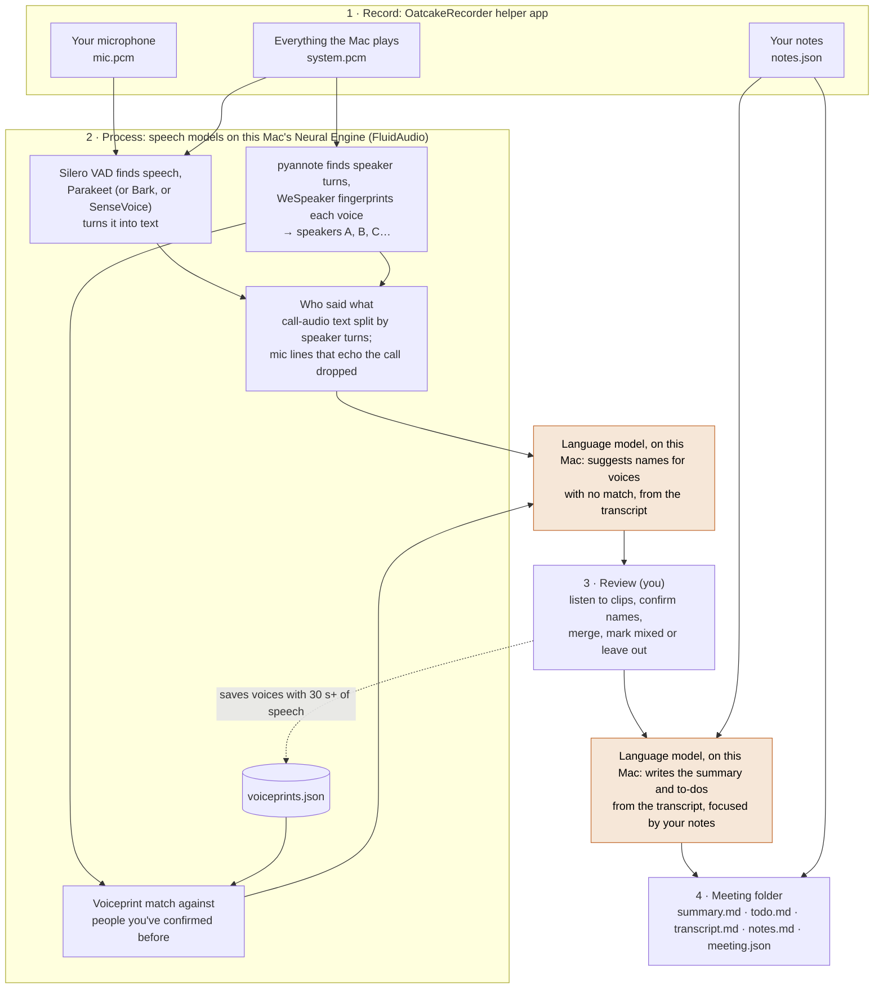

# How it works

Everything runs on this Mac, and nothing from a call is sent anywhere. Silero, Parakeet (or the
Bark or SenseVoice you choose instead), pyannote and WeSpeaker are small speech models (Parakeet
is 0.6B parameters), run on the Neural Engine
through [FluidAudio](https://github.com/FluidInference/FluidAudio)'s Core ML builds: they turn
audio into text and voices into fingerprints, take no prompts, and can't write anything else. The
two orange steps are the only language model: one of Qwen's or Google's, which Oatcake downloads once and runs itself
with [llama.cpp](https://github.com/ggml-org/llama.cpp) (see [Language model](models.md#language-model)). It only ever sees
text (the transcript and your notes), never audio. You can point Oatcake at a model server of
your own, on your Mac or your network, instead.

## The window

With a folder or **All meetings** chosen, or a meeting open, the window is laid out as Mail's is,
in three columns: the sidebar, the meetings in that folder, and the meeting itself. The other
screens (Home, To-dos, Record a call, a call being recorded, Who's who) have the rest of the window
to themselves beside the sidebar, with their own name as the window's title. One toolbar runs
across the top: over the meeting list, the folder's name, how many meetings it has, and the search
button; over the screen on the right, its own controls, what it is at the left and what can be
done at the right. What doesn't fit goes in the toolbar's » menu. The window can be as narrow as
720 points, about half a laptop's screen. **View › Hide Sidebar** (⌃⌘S), or the button beside the
window's buttons, hides the sidebar. With the meeting list showing in a window too narrow for the
sidebar as well, the sidebar makes way, as in Mail, and comes back when the window is wider; show
it to have it anyway.

The sidebar has a recording in progress, Home, To-dos, Upcoming, Who's who, folders, and any
meetings at the top level. A one-off call with no folder of its own is saved at the top level;
drag it onto a folder to file it. **All meetings**, at the top of the Meetings section, lists every
meeting, whatever folder it's in. A folder lists only its own meetings, and says so when they're all
in the folders inside it; an empty folder offers **Record here** under the folder's name, beside the
list. Drag the dividers to resize the sidebar and the meeting list; they keep those widths
when you switch screens. Settings (⌘, or the menu bar item) is its own window, in panes; changes
apply as you make them (see [Settings](settings.md)). Dates and times are written the way your
Mac's region writes them ("Thu 29 Oct" or "Thu, Oct 29"), on its 12- or 24-hour clock. A note
at the bottom of the window says what just happened; one that says something went wrong stays
until you click it.

Oatcake opens where it was when it was last closed: Home, To-dos or the meeting that was open (on
the tab last chosen), with the folder that was listed; or on a recording that was still going. Home
shows upcoming calls, the same rows as the sidebar's Upcoming (click one for Record a call,
right-click to ignore it), with **Join the call** beside the one on now or next. The
sidebar's **Record a call** button is beside it, or **Return to the call** during a call. When to-dos are enabled, Home
also shows up to five open items, earliest due first, with their assignees and due dates. Add or
tick off to-dos on Home, or choose **View all to-dos** to manage the full list.

⌘N opens **Record a call**, and ⌥⌘F (or the search button over the meeting list) opens search over
the window. It finds meetings by their title, folder, summary, to-dos, notes and transcript as you
type, newest first, with the words marked; one found by its text shows the line with them. It says
**Searching…** until every meeting's text has been looked through, then how many it found. ↑ and
↓ choose a meeting, Return or a click opens it on the tab where the words are, with them in Find and
marked, and Escape or a click outside closes search. Search keeps its words and results: open it
again and ↓ goes on to the next. ⌘F finds words on the tab you're reading, marked wherever they are;
on the transcript, ⌘G and ⇧⌘G step through the lines with every word. After following a link (a
to-do's, a citation in Ask, a search result), ⌘[ goes back to where you were and ⌘] forward again.

Everything is in the menus: File (New Folder, Refresh Calendars, Move to Trash), Edit (Find, Search
Meetings, Ask About Your Meetings), View (the meeting's tabs, and Bigger Text, Smaller Text and
Actual Size for what you read and type), Go (Back, Forward, Home, To-dos, All Meetings), Meeting
(everything in the open meeting's **⋯** menu), Recording (Record a Call…, Stop Recording…, Join Call,
Show Live Notes) and Help, which opens these pages. [Keyboard shortcuts](keyboard-shortcuts.md)
lists the keys. Bigger Text (⌘+), Smaller Text (⌘-) and Actual Size (⌘0) change the size of
summaries, transcripts (the meeting's, the live one and Who's who's), notes, answers, the meeting
list, to-dos, times and section headings.

Oatcake follows the Mac's accessibility settings (System Settings › Accessibility › Display). With
**Reduce motion**, the recording dot doesn't pulse, the refresh arrow doesn't turn, notes at the
bottom of the window fade rather than slide in, and a transcript or Ask jumps to a line rather than
scrolling smoothly to it. With **Increase contrast**, the edges of fields and cards are darker, and
notices and times get an edge of their own. An error's symbol is an octagon, not the warning's
triangle, so the two differ in more than colour. VoiceOver reads out each note at the bottom of
the window (an error's note goes when you press it) and says when an answer in Ask is ready, and
the menu bar item says the time until the next call, or how long a call has been recorded.

By default, closing the window keeps Oatcake running in the background, checking for calls and
sending reminders. It stops appearing as a running app in the Dock and stays in the menu bar.
Choose **Open Oatcake** there to bring back the window and Dock icon. Turn off **Run in the
background** in Settings › General to quit when the last window closes, once any recording or work
has finished. **Quit Oatcake** (⌘Q) stops Oatcake and its call checks regardless of this setting.

## 1. Record

**Record a call**, or click an event under Upcoming. Pick the folder (a calendar event picks the
folder named like it, or the one its earlier meetings are in, or offers a new one for a recurring
event); leave the title blank to use the folder's name. The screen shows the event's attendees
and its **Join the call** button, the open to-dos from the latest earlier meeting in that folder
that has any (ticking one updates its `todo.md`), and takes prep notes, which open the call's
notes: type them one at a time or paste a list, which becomes a note per line. They're kept for
that call until it's recorded (for up to 30 days), so you can write them ahead and come back.

If you've set up [summary templates](settings.md#summaries), choose one on **Record a call**.
For a calendar event, Oatcake suggests the template from the latest saved meeting with the same
title, or **Default** if there isn't a matching template. You can change the choice for this
recording. Oatcake keeps it with the saved meeting and uses it for the first summary, whether
that's written automatically or later. Selecting a template doesn't turn on automatic summaries.

Your microphone is recorded as you; everything the Mac plays (Zoom, Meet, Slack, anything) is
recorded as the other people. During the call, write one point per line: each is stamped with the
time you started typing it, and every line stays editable. The recorder is a small helper app
(`Sources/OatcakeRecorder`) inside Oatcake; macOS asks for microphone and system-audio permission
in Oatcake's name, once; if it hasn't started after a few seconds, the live screen says to look
for that prompt. Until the recorder has sent any audio, **Cancel** throws the recording away (and
**Close** does, if it never starts); either asks first if you've typed notes.

Pick the microphone on the record screen, from the mic button during the call, or in Settings ›
General: "Same as Mac" follows System Settings › Sound; a chosen mic is used until it's unplugged,
then the Mac's input until it's back. Changing mic mid-call carries on recording, with the switch
filled with silence so your track stays lined up with the call. The call audio is watched the same
way: if it stops arriving (the Mac slept with its lid closed) or its format changes (headphones
connected), it's started again, with the gap filled with silence.

You're warned after 30 seconds of a silent mic or no call audio, on the call's screen and with a
notification, since you're probably looking at the call (the no-call-audio notification only
while a calling app has the microphone: dictating on your own, there's no call audio to miss). The
silent-mic notification comes once a recording, and once more if you change microphone (a headset
that cuts out room noise is silent whenever you aren't talking); the call's screen goes on saying
so for as long as the mic is silent. The recorder stops by itself before the disk is full (with
100 MB left), so there's room to finish and process the call. If the recorder stops or never starts
(no permission, a full disk), Oatcake notices (within a couple of seconds once it stops, or 15
seconds after it was launched if it hasn't started; time spent on macOS's permission questions
isn't counted), says so the same two ways, and keeps and processes whatever was recorded. A
recorder that's stopped part-way still leaves where each track starts, so the two stay lined up;
when it couldn't, Who's who says your lines may be out of step with the call's. Stop asks
first (Return stops), and so does quitting Oatcake while a call is being recorded, analysed or summarised, a draft
for sharing or an answer is being written, or meetings are being imported. Quitting also asks when
it would lose something you've typed: notes for a call that couldn't be recorded, edits that
couldn't be saved, or names in Who's who. A question asked while another is on screen waits for
that one to be answered.

### Live transcript

Beside your notes, **Transcript** shows the call as it's said, a moment after each pause (a second
helper, `Oatcake --live`, transcribes the audio as the recorder writes it). Your lines are yours.
Each line from the call side gets a fingerprint, and the name of whoever it sounds like: someone
Oatcake knows by voice, or someone you've named on another line. A line nobody can be sure of gets
an obviously made-up name, a different one every time ("Mystery Guest", "Captain Placeholder"…).
The transcript follows each new line while you're at its end. Scroll up to read back and it stays
where you are, with **Jump to latest** to take you back down.

Click a line's name to say who said it: the menu lists the people Oatcake knows by voice and the
people on the calendar invite. Oatcake follows that voice for the rest of the call, and fills in
the earlier lines that sound like it too. Naming a line someone else when Oatcake had put a known
person's name on it puts that person's saved voiceprint aside for this call. **Not Jane Doe** (or
whoever it was) in the same menu undoes a name you gave. The names you give are kept in the recording (`live-names.json`), and Who's who
starts from them after the call (see [Review](#3-review-whos-who)).

One line gives a rougher fingerprint than a whole call, and can hold two people, so the live names
are for following the call; the voices are told apart properly once it's over. When the live
transcript starts again partway through a call (Name voices turned on, or Oatcake reopened), it
catches up from the start two minutes at a time, showing lines as it goes. If its helper stops,
the pane says so; turning the live transcript off and on again starts another. Matching uses the same rule
as review (see [Accuracy](models.md#accuracy)). Settings › General turns the live transcript off,
or only the naming of voices, which saves about 180 MB of memory during a call.

### Calls are noticed

When a calling app or a browser starts using your microphone and nothing is being recorded, a
notification offers **Start recording** (under the calendar event happening now, if there is
one: of two that overlap, the one that started last, so a call inside a day-long block is the
call). When a recording has had a calling app on the microphone, and that app has let go and the
call audio has been quiet for 15 seconds, a notification says the call seems to have ended; 30
seconds later the recording stops and starts processing, unless you choose **Keep recording** (on
the notification or the call's screen) or the call comes back. Music still playing, or a call
you're only muted on, keeps it going. Oatcake tells which apps have a microphone open from Core
Audio (`Sources/OatcakeCore/CallDetector.swift`); it doesn't listen until you record. Both are
switches in Settings › General.

### The menu bar

While a call is being recorded the menu bar shows its running time, with **Stop Recording…**
(which asks first) in its menu. When not recording, the Oatcake icon is there if **Run in the
background** is on or calendar details are shown. **Show my next call in the menu bar** in Settings
› Calendars › Reminders adds the time until your next call and lists up to six calls today and
tomorrow (click one to open its Record a call screen). The menu offers **Record a Call…** when not
recording, then
**Settings** in its own section, then **Open Oatcake** and **Quit Oatcake**. The menu bar item is
drawn by a third helper, `Oatcake
--menu-bar`, a menu-bar-only app: macOS doesn't show a Dock app's menu bar menu while another app
is in full screen.

A recording started from a calendar event keeps the event's **Join the call** button on its
screen, for when you press record before joining.

## 2. Process

On this Mac, in the background. The speech model (Parakeet unless you've chosen another)
transcribes both tracks. The call audio is split into
voices by FluidAudio's batch diariser (pyannote segmentation, WeSpeaker fingerprints, VBx
clustering). It runs as a helper process (`Oatcake --analyse`), so a problem there can't take the
window or a recording in progress with it. Recordings are analysed one at a time (each loads the
speech models and its whole call), the others waiting their turn; the helper stops when Oatcake
quits, and the analysis starts again from the beginning next time. A track that can't be read
stops the analysis, rather than counting as silence. Mic lines that repeat the call audio (speaker echo) are
dropped. Voices you named in the live transcript get those names (a voice takes the name given to
the lines it said most of); known voices are recognised from saved voiceprints; other names are
suggested from the conversation by the summary model, quoting the words that gave it away (not when
After a call is set to save the transcript only: see
[Saving without Who's who](#saving-without-whos-who)). The recording waits under
Who's who, transcribing, with its step (1–5), and the Dock icon's badge counts the recordings waiting there.
When one is ready for Who's who and Oatcake isn't in front, a notification says so. A
failure shows the reason, with **Try again** and **Discard…** (and says when trying again won't help); **Discard…** is in the toolbar while
it's being transcribed and on Who's who as well, and in the menu you get by Control-clicking the
recording in the sidebar. Once it's transcribed, it's **Ready to check**. A recording whose Who's who can't be opened says why, with **Try again**
(it's analysed again) and **Discard…**. A recording whose recorder went without being able to
finish it (the disk was full) still waits here, rather than being hidden until Oatcake reopens.

## 3. Review (Who's who)

Change the title or the folder it's saved in if you want to. One card per voice: play its clips
(the first words said in each are under it, so voices can be told apart without sound),
confirm or type the name, or pick one of the people on the call's calendar invite (each is offered
until they've been given a voice) (with where the suggestion came from: named by you during the
call, recognised from before, or guessed from the conversation), merge it into another
voice or into you, say **Several people share this voice** ("Several people"), or **Leave out of this meeting** when it isn't part of the
call (people talking in the background, say): its lines then stay out of the transcript, the
summary and the to-dos. **Put back** undoes leaving one out, and **Undo** a merge. Unnamed voices
are saved as "Voice 1", "Voice 2"… The transcript beside it updates as you name voices. Confirmed
voices with 30+ seconds of speech are saved, so they're recognised next time.

### Saving without Who's who

Settings › General › **After a call** can save each call as soon as it's transcribed, instead of
waiting here: **Save with a summary**, or **Save the transcript only** (no summary or to-dos).
Voices you named during the call, and voices Oatcake is sure it recognises from before, keep their
names (a closer match than this screen asks for, since nobody is looking), and every other voice is "Voice 1", "Voice 2"…, whatever the
model guessed from the conversation: a guess, or a match that wasn't sure enough, waits on the
voice's card as a suggestion. **Save the transcript only** doesn't ask the model for names at all, so
the call is saved as soon as it's transcribed and only a match that wasn't sure enough waits as a
suggestion. No voice is remembered from names nobody checked.

The meeting says it was saved without checking who's who: **Check who's who…** opens this screen for
it, and **Update meeting** writes its transcript and `meeting.json` again in place, puts the new
names where the old ones were in its summary and to-dos (as whole words: each "Voice N" stands for
one voice, so it's an exact swap wherever the model wrote it that way), and leaves your notes and
its title as they are. Name them while the summary is still being written and it's written again
from the named transcript. **Keep these names…** keeps the names it has, once you've confirmed
that its voice clips are deleted. If a call can't be saved by
itself, it waits here as usual, and so does one with audio in which no speech was found (so it
can be checked, and its audio isn't deleted). Quit while names are being suggested, and they're
suggested again (and the call saved) when Oatcake next opens.

## 4. Save

The meeting is a folder in the folder you picked: `2026-11-05 1400 Weekly sync/` with
`summary.md`, `todo.md` (action items, as `- [ ] Task — Owner — due Fri, Oct 30 — [12:34]`),
`transcript.md`, `notes.md` (your own notes, untouched; prep notes have no time) and
`meeting.json` (title, times, participants), plus `draft.md` once you've written a
[draft for sharing](#draft-for-sharing). A long turn in the transcript is broken at a pause
about every half minute, each part with its own time.

Saving doesn't involve the summary model: the meeting is written straight away with its transcript
and notes, and its summary and to-dos are written in the background and appear in the meeting when
they're ready. Your notes steer what the summary focuses on but aren't copied into it. If the
summary can't be written (the model's download was interrupted, a server of your own that's down),
the meeting says why in plain words (the raw message is behind Details) and shows **Write summary**
to try again later.

Summaries, to-dos, drafts for sharing and Ask's answers call everyone they/them. The model only
has a name to go on, and guessed wrong: a man with a name it read as a woman's was "she", and
telling it his pronouns still left "she" in about 1 summary in 4. So every he/him/his and
she/her/hers it writes is changed to they/them/their afterwards, with the verb after it agreeing
("she needs" becomes "they need"). That's done for English only; in another language "he" or
"her" can be another word.

### Reading and editing

Tabs, in the toolbar over the meeting: Summary (with the meeting's to-dos at the top), Transcript
and My notes (⌘1–⌘3), and Draft (⌘4) in a meeting that has a [draft for sharing](#draft-for-sharing), each
laid out (**Read**) or as editable Markdown (**Edit**) from the switch at the top right of the tab (saved as you type;
Summary shows `todo.md` and `summary.md`). In **Read**, a summary or draft is one piece of text: a
selection can run across its paragraphs, headings, lists and tables, and copies with its
formatting. If the file changes while you type (its summary
arrives, or it's edited in another app), Oatcake doesn't save over it: it shows the file as it is
now and keeps what you typed beside it, as `summary (your version).md` and so on, and says so.
Everything else that can be done to the meeting is in
the **⋯** menu at the right of the toolbar, and the same commands are in the Meeting menu and the
meeting's right-click menu in the list. Those for the tab you're on (**Copy**, **Regenerate
Summary**…) are greyed out on a tab they don't apply to, and in the right-click menu of a meeting
that isn't open. **Copy** puts the tab you're on (the summary with its
to-dos, the transcript, or your notes) on the clipboard under the meeting's title and date,
formatted for Google Docs, Pages or mail and as Markdown for anything that only takes plain text,
and **Share** sends the same text with Mail, Messages or another app.

### Listening to the recording

If a meeting has saved audio, a player sits below its title, with the recording's length. Use the
slider or click a time in the rendered transcript to jump to that point in the recording, before or
after pressing play. Space plays and pauses while no text field has the keyboard, and ⌥← and ⌥→ go
back and on 15 seconds. If playback is paused, it
stays paused at the new time. Playback stops when you leave the meeting. For calls recorded in
Oatcake, turn on [Keep call audio after saving](settings.md#storage) to make audio available for
future meetings.

### Regenerate and summary templates

To write a summary or its to-dos again (after changing the instructions in Settings › Summaries,
say), choose **Regenerate Summary** or **Regenerate To-dos** from the **⋯** menu on the Summary
tab and confirm. With [summary templates](settings.md#summaries) set up, Regenerate Summary
lists them: the meeting's summary is written with the one you pick, and the meeting keeps it for
any summary written of it later. Only that part is asked for and replaced, edits and ticks
included; the rest of the meeting stays as it is. The old one stays until the new one is ready,
and stays if it fails or is changed somewhere else meanwhile.

### Draft for sharing

**Draft for Sharing…** in the **⋯** menu on the Summary tab has the model write the meeting's
summary and
to-dos again for other people to read, following your
[draft for sharing instructions](settings.md#summaries), plus anything you ask for that draft alone
("shorter, and leave out the budget"). It's given the summary and to-dos as they are, with your
edits, and nothing else: not the transcript and not your notes, so it can't bring back anything
you took out of the summary. The draft goes in the meeting's `draft.md` and opens in a **Draft for
Sharing** tab (⌘4), which only meetings with a draft have; edit it there, then **Copy** or
**Share** it. Asking again replaces the draft, edits included, and says so first; the old draft
stays until the new one is ready, and stays if it fails or is edited meanwhile. Renaming speakers
renames them in the draft too.

### To-dos

Tick to-dos off in place, and ⌘Z ticks one back; a due date can be a date ("Fri, Oct 30") or a
day as it was said ("Friday", "tomorrow", "end of the week"), counted from the day of the meeting;
a to-do's time (on the line under it, after its owner and due date) jumps to that moment in the
transcript. **To-dos** at the top of the sidebar gathers every meeting's to-dos (open and overdue
counts beside it): Open / Done / All, grouped by due date, folder or owner, and everyone's, yours
("Mine" is your name from Settings) or one person's. It keeps those choices while Oatcake is open.
Ticking one there updates that meeting's `todo.md`, and under Open it leaves the list a moment
later, once its tick and line have been seen (⌘Z brings it back, and it's under Done too). Add a to-do under a meeting's Summary and it goes in that
meeting's `todo.md`; add one on the To-dos page and it goes in the Meetings folder's own
`todo.md`, owned by you unless you name someone. Type owner and due date after dashes, as the
page says under the field: `Send the deck - Jane - due Fri, Nov 6`. Only the last piece that isn't
a due date is the owner, so a task can have a dash of its own (`Compare A - B pricing - Jane`).
Right-click one of your own list's to-dos to **Edit** it in place (Return saves, Escape doesn't)
or **Delete** it. If you keep your tasks somewhere else, turn off
[Collect to-dos](settings.md#general) in Settings › General.

### Organising meetings

Organise meetings by dragging them onto folders, or with **Move To** in a meeting's menus, which
lists every folder; ⌘-click or ⇧-click selects several, and they all move. Right-click a meeting for
the same commands as its **⋯** menu, among them **Rename…**, **Move To**, **Show in Finder** and
**Move to Trash**; right-click several for **Move To**, **Show in Finder** or **Move to Trash**, which asks first for several.
⌘⌫ (File › Move to Trash) moves the meetings selected in the list to the Trash (asking first for
several) and opens the next one, as in Mail, and ⌘Z puts back what was just moved. Renaming a meeting changes its title (in
`meeting.json`) and its folder's name, which keeps its date. Dragged out of Oatcake, a meeting is
its folder (into Finder or a mail, say), or its summary where only text goes.
Folders can hold folders. Click the arrow next to a folder's name, or press → and ←, to show or hide
its subfolders. Right-click a folder for **New Folder Inside…**, **Rename…** (or press Return),
**Show in Finder** or **Move to Trash** (or ⌘⌫, which asks first if it holds meetings). A folder
or meeting that can't be created or renamed (another already has the name, say) is asked about
again with what you typed, and the note at the bottom of the window says why. Finder and
the app stay in step: a folder or meeting that goes from Finder while it's open gives way to the
nearest folder that's still there. The meeting list's width drags, like the sidebar's.

### Rename People

**Rename People…** in a meeting's **⋯** menu puts a wrong name right after the meeting is saved,
or
names a "Voice 2": it lists the transcript's speakers, each with their first words, and a field for
another name. Only that meeting changes: the transcript's labels (never what was said), the names
in its summary and to-dos, and its people in `meeting.json`. Two names can swap, and giving two
speakers one name makes them one, which the sheet says before you choose Rename, since it can't be
undone; "Several people" stays as it is. The fingerprint saved from that
call goes with the name, so the next call isn't recognised as the wrong person too. It stays only
when the new name is the old one spelt out ("John" → "John Smith") and the voice clearly matches
their other calls (Settings › People renames a person everywhere). A meeting saved without checking
who's who has **Check who's who…** instead.

## 5. Ask

Use **Ask about your meetings…** at the bottom of Home to search across saved meetings without opening
one first ("when did Jane Doe first raise the launch date?"). On a meeting page, Ask starts with
that call, so you can ask "what did we decide about hiring?" without naming the meeting. The model
gets the open call’s summary, to-dos, notes and transcript (or the closest parts of a long transcript).
If the question reaches beyond the open call, Oatcake also searches other meetings and favours ones
in the same folder. From Home it searches the whole library without favouring a folder. Search results
include summaries, to-dos and matching transcript lines. The model never opens a file or runs
anything itself. Answers link to the meetings they
draw on, and a time in an answer opens the transcript at that moment. An answer is one piece of
text: select any stretch of it, or all of it, and copy. Web links in an answer are shown as text,
not made clickable. Follow-ups continue the same conversation as you move between Home and meetings.
Choose **New chat** to start over. **Stop** ends an answer early, and Esc or **Hide** puts the
chat away. The first question about a call takes longest, while the model reads it; follow-ups
about the same call are quicker.
